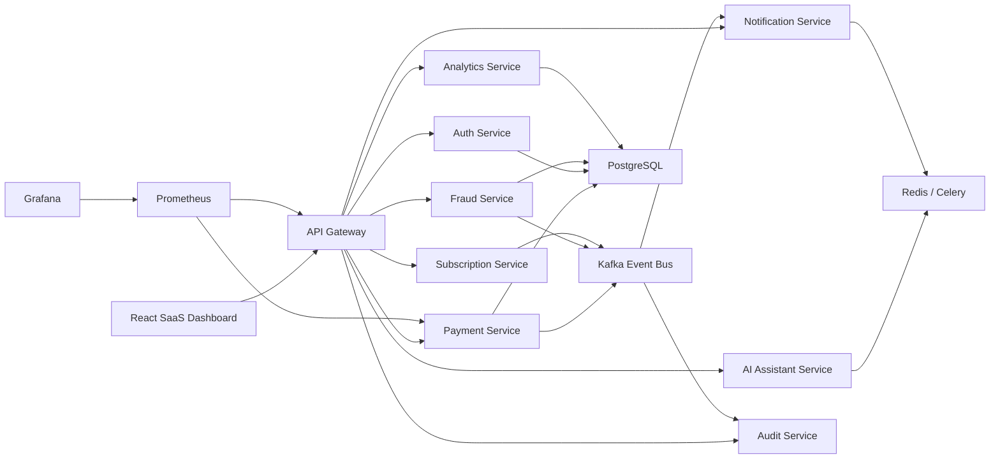

# FinFlow AI

Enterprise Financial Operations, Fraud Intelligence, and Payment Automation Platform.

FinFlow AI is a production-oriented fintech SaaS monorepo with FastAPI microservices, a React dashboard, PostgreSQL, Redis, Kafka, Celery, Prometheus, Grafana, and NGINX.

## Services

- `api-gateway`: routing, authentication guardrails, rate limiting, WebSockets, request logging.
- `auth-service`: JWT auth, refresh tokens, RBAC, MFA, sessions, devices, suspicious login detection.
- `payment-service`: transaction workflow engine, approvals, refunds, retry queue, exports.
- `fraud-service`: fraud cases, risk scoring, anomaly detection, velocity checks, recommendations.
- `analytics-service`: dashboards, forecasts, budget risk, financial KPIs.
- `ai-assistant-service`: retrieval-aware financial assistant, receipt extraction, categorization.
- `subscription-service`: recurring payment detection, renewal and price alerts.
- `notification-service`: email/in-app notifications and alert fanout.
- `audit-service`: searchable audit, API call and workflow history.

## Quick Start

1. Copy `.env.example` to `.env`.
2. Start the stack:

```bash
docker compose up --build
```

3. Run migrations:

```bash
docker compose run --rm auth-service alembic upgrade head
```

4. Open the frontend at `http://localhost:5173`.

## Local Development

Backend services share the `backend/shared` package and expose FastAPI apps through `services/<service>/app/main.py`.

```bash
pip install -r backend/requirements.txt
pytest backend/tests
```

Frontend:

```bash
cd frontend
npm install
npm run dev
```

## Architecture



## API Documentation

Each service exposes OpenAPI docs at `/docs` and health checks at `/health`.

The Postman collection lives in `docs/postman/finflow-ai.postman_collection.json`.

## Security

Implemented foundations include password hashing, JWT access tokens, refresh token persistence hooks, RBAC dependencies, MFA verification flow, device/session tracking, IP-aware suspicious login scoring, request IDs, secure headers, and rate limiting.

## Production Notes

- Replace demo secrets in `.env.example`.
- Run services behind TLS at the edge.
- Configure Kafka retention and dead-letter topics.
- Add managed PostgreSQL backups and point-in-time recovery.
- Configure OpenAI and SMTP credentials through a secret manager.

