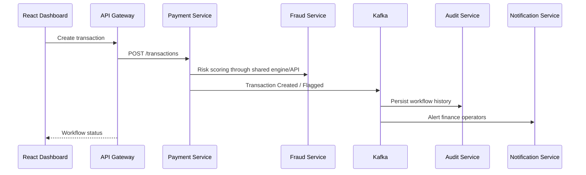
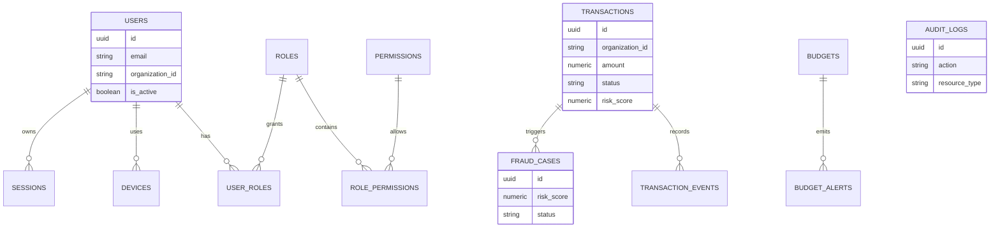

# FinFlow AI Architecture

FinFlow AI uses microservices behind an API gateway. Services are isolated by bounded context but share foundational libraries for logging, configuration, security, database connectivity, schemas, events, and core domain primitives.

## Event Flow

## Database ER Diagram

## Operational Model

- PostgreSQL is the source of truth.
- Redis powers Celery queues and cache-ready workflows.
- Kafka carries durable domain events.
- Prometheus scrapes service metrics.
- Grafana provisions an overview dashboard.
- NGINX handles edge routing for frontend, API, and WebSocket traffic.

