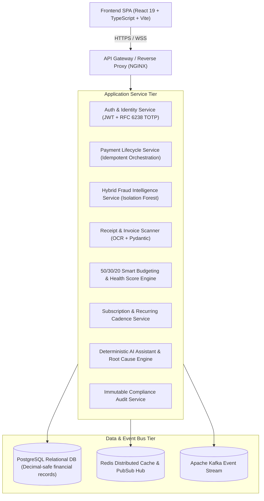

# FinFlow AI Architecture Documentation

## 1. System Architecture Overview

FinFlow AI implements a microservice-ready modular architecture designed for high throughput, strict data isolation, and auditable operational intelligence.



---

## 2. Transaction Lifecycle State Machine

Every financial transaction flows through strict state transitions guarded by database transactions and audit logging:

```
INITIATED
   │
   ▼
VALIDATING (Validates currency, account balance constraints, idempotency)
   │
   ▼
RISK_ANALYSIS (Hybrid Isolation Forest ML + 5 behavioral heuristic rules)
   │
   ├── High/Critical Risk or Flagged Descriptor ──► FLAGGED / PENDING_APPROVAL
   │                                                    │
   │                                                    ▼ (Manual Manager Clearance)
   │                                                 SUCCESS
   │
   └── Low/Medium Risk (<50 Risk Score) ──────────► PROCESSING ──► SUCCESS
                                                                     │
                                                                     ▼
                                                             AUDIT_RECORDED
                                                                     │
                                                                     ▼
                                                             EVENT_DISPATCHED
```

---

## 3. Hybrid AI Fraud Intelligence Engine

The fraud detection service utilizes an ensemble combining:
1. **Machine Learning Anomaly Detection**: `Isolation Forest` (Liu, Ting, Zhou 2008) calculating path lengths over 4D statistical feature vectors: `[log_amount, hour_of_day, day_of_week, 5_min_velocity]`.
2. **Behavioral Rule Heuristics**:
   - `RUL-AMT-SPIKE`: Standard deviation z-score analysis against historical 30-day average.
   - `RUL-VEL-BURST`: High-velocity burst analysis tracking rapid transaction spikes within 5 minutes.
   - `RUL-DEV-UNRECOGNIZED`: Untrusted device fingerprint check.
   - `RUL-AUTH-FAILED-SURGE`: Preceding consecutive payment failure surge.
   - `RUL-MERCHANT-HIGH-RISK`: Blacklisted/monitored merchant descriptor surveillance.
3. **Explainable AI Reasoning**: Outputs human-readable triggered signals, evidence weights, and recommended actions (`APPROVE`, `MANUAL_REVIEW`, `STEP_UP_AUTH`, `BLOCK`).

---

## 4. 50/30/20 Budgeting Framework & Health Score

- **Needs (50% Target)**: Rent, utilities, cloud servers, payroll taxes, healthcare, insurance.
- **Wants (30% Target)**: Team dining, travel, incidental shopping, non-essential SaaS.
- **Savings & Reserves (20% Target)**: Operating cash reserve buffers, corporate treasury investments.

### Transparent Health Score (0-100)
Calculated deterministically across 5 weighted pillars:
- **Savings Rate Pillar (30 pts)**: Proportion of net income retained in reserves.
- **Budget Adherence Pillar (25 pts)**: Variance against 50/30/20 category benchmarks.
- **Recurring Payment Burden (20 pts)**: Monthly subscription commitments relative to revenue.
- **Cash Flow Margin (15 pts)**: Net operating cash margin.
- **Risk Profile (10 pts)**: Absence of active fraud cases or high-risk flags.

---

## 5. Event-Driven Messaging & Outbox Pattern

Asynchronous distributed events emitted across the lifecycle:
- `transaction.created`
- `transaction.completed`
- `transaction.failed`
- `fraud.detected`
- `receipt.uploaded`
- `budget.alert_triggered`
- `subscription.renewal_due`
- `audit.record.created`
